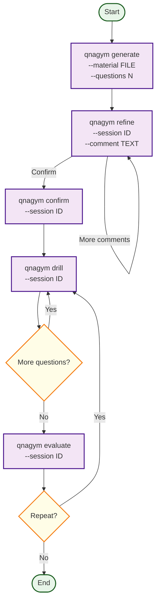

# Q&A gym

Knowledge acquisition practice. CLI tool.

## Quick Start

```bash
# Install
python3 -m venv .venv
source .venv/bin/activate
pip install -e .

# Start local model (Ollama) - example command
ollama pull gemma3:12b
OLLAMA_CONTEXT_LENGTH=16384 ollama serve

# Use qnagym
qnagym generate --material "$(cat example/quadratic_equations.md)" --questions 5
qnagym refine --session <id> --comment "q1:make it simpler"
qnagym confirm --session <id>
qnagym drill --session <id>
qnagym evaluate --session <id>
qnagym repeat --session <id>
```

> **Note:** Default model (`gemma3:12b`), API key (`ollama`), and base URL (`http://127.0.0.1:11434/v1`) are defined in [`src/qnagym/contracts/constants.py`](../src/qnagym/contracts/constants.py) and [`docs/spec/config.md`](docs/spec/config.md). Override via flags, env vars (`QNAGYM_*`), or `qnagym.toml`.

## User Scenario



1. **Generate** — Provide a topic/material, get Q&A pairs
2. **Refine** — Comment on questions/answers to improve them (repeat as needed)
3. **Confirm** — Lock in the Q&A bank for practice
4. **Drill** — Practice: answers hidden, one question at a time
5. **Evaluate** — Get scored feedback vs agreed answers
6. **Repeat** — Practice again, track improvement, get break suggestions

## Commands

| Command | Description |
|---|---|
| `qnagym generate` | Generate Q&A from material |
| `qnagym refine` | Refine Q&A via comments |
| `qnagym confirm` | Confirm Q&A bank for practice |
| `qnagym drill` | Practice session |
| `qnagym evaluate` | Score answers |
| `qnagym repeat` | Repeat practice |
| `qnagym reset` | Reset to refine mode |
| `qnagym list` | List sessions |
| `qnagym show` | Show session details |

## Configuration

Defaults (local-first, no-cost AI):
- `base_url`: `http://127.0.0.1:11434/v1` (Ollama)
- `model`: `gemma3:12b`
- `temperature`: `0.0` (reproducible)

Override via flags, env vars (`QNAGYM_*`), or `qnagym.toml`.

## Docs

- [`docs/spec.md`](docs/spec.md) — Product spec (index)
- [`docs/constitution.md`](docs/constitution.md) — Principles
- [`docs/development.md`](docs/development.md) — Developer guide
- [`docs/adr/`](docs/adr/) — Architecture decisions
