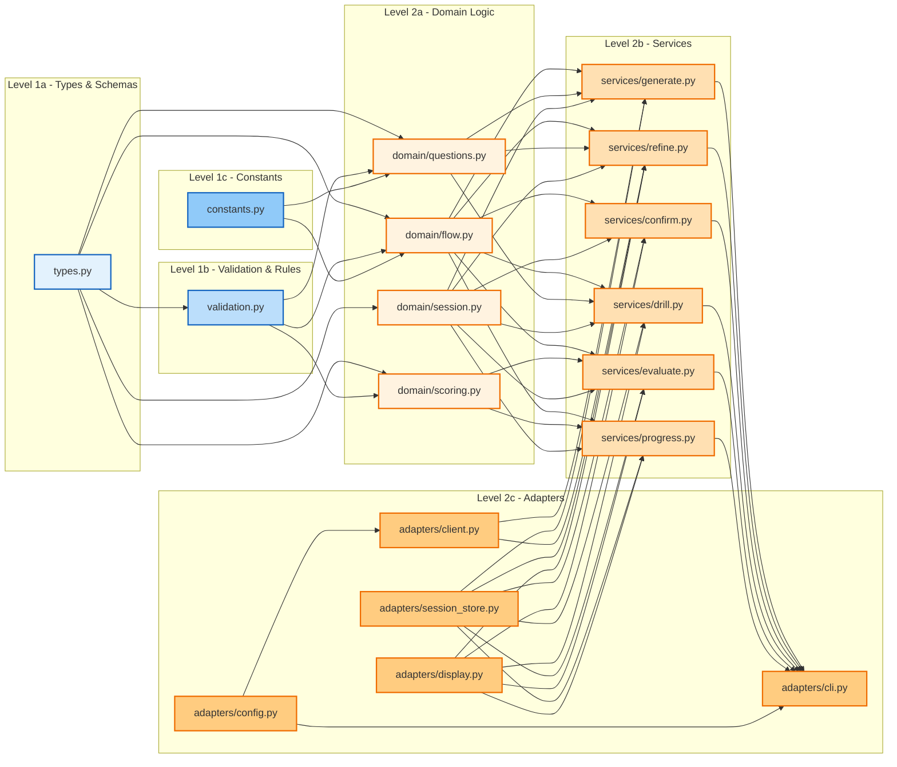
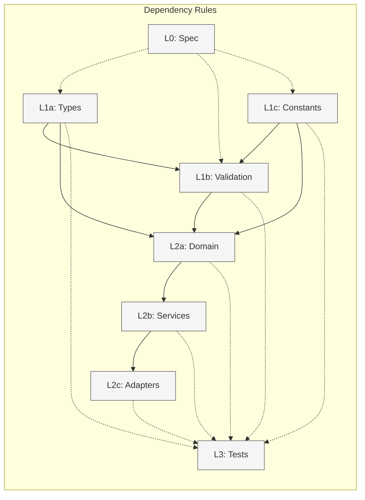

# ADR 0002: Architecture Dependency Model

## Status

Accepted

## Context

qnagym follows Spec-Driven Development (SDD) per [ADR 0001](0001-spec-driven-development.md). The architecture has **granular levels** with strict one-way dependencies, mapping SDD to Clean Architecture:

| Level | Name | Artifacts | Responsibility |
|-------|------|-----------|----------------|
| 0 | **Spec Contracts** | `docs/spec/*.md`, `docs/constitution.md`, `docs/adr/*.md` | Source of truth; human-readable contracts |
| **1a** | **Types & Schemas** | `src/qnagym/contracts/types.py` | Pure data shapes (dataclasses, TypedDict, enums) — no logic |
| **1b** | **Validation & Rules** | `src/qnagym/contracts/validation.py` | Validators, guards, business rules derived from spec |
| **1c** | **Constants & Config Keys** | `src/qnagym/contracts/constants.py` | `VALID_STATUSES`, config keys, error codes — immutable values |
| **2a** | **Domain Logic** | `src/qnagym/domain/` | Pure business logic (flow rules, question generation, scoring) — no I/O |
| **2b** | **Use Cases / Services** | `src/qnagym/services/` | Orchestration (generate, refine, confirm, drill, evaluate, progress) — depends on 1a,1b,1c,2a |
| **2c** | **Adapters (I/O)** | `src/qnagym/adapters/` | CLI, ModelClient, SessionStore, Display — depends on 1a,1b,1c,2a,2b |
| 3 | **Verification** | `tests/` | Contract tests, unit tests, integration tests |

## Decision

### Dependency Rules

1. **Level N may only depend on Level N-1 or same sub-level** — never on Level N+1
2. **Level 1 (contracts) must not import from Level 2 (app)** — contracts are pure definitions
3. **Level 2a (domain) imports from Level 1 only** — pure logic, no I/O
4. **Level 2b (services) imports from Level 1 and 2a** — orchestration
5. **Level 2c (adapters) imports from Level 1, 2a, 2b** — I/O boundary
6. **Level 3 (tests) imports from all Level 1 & 2** — verification
7. **No cycles** — verified by automated analysis

### Sub-level Dependency Map

```
L1a (Types) ◄─── L1b (Validation) ◄─── L1c (Constants)
    │              │                    │
    ▼              ▼                    ▼
L2a (Domain) ◄─── L2b (Services) ◄─── L2c (Adapters)
    │              │                    │
    └──────────────┴────────────────────┘
                    │
                    ▼
                 L3 (Tests)
```

- **L1a, L1c → L1b**: Validation uses types and constants; types and constants are independent bases
- **L2a → L1a, L1b, L1c**: Domain logic uses types, validation, constants
- **L2b → L1*, L2a**: Services orchestrate domain logic
- **L2c → L1*, L2a, L2b**: Adapters (CLI, HTTP, storage) wire everything

---

## Mermaid Diagrams

### 1. Granular SDD Level Architecture (Logical Dependencies)

```mermaid
graph TD
    subgraph L0["Level 0 - Spec Contracts - Source of Truth"]
        direction TB
        SPEC_CLI["docs/spec/cli.md"]
        SPEC_SESSION["docs/spec/session.md"]
        SPEC_CONFIG["docs/spec/config.md"]
        SPEC_FLOW["docs/spec/flow.md"]
        SPEC_PROMPTS["docs/spec/prompts.md"]
        SPEC_QUESTIONS["docs/spec/questions.md"]
        SPEC_TRACE["docs/spec/traceability.md"]
        CONSTITUTION["docs/constitution.md"]
        ADR_0001["docs/adr/0001-spec-driven-development.md"]
    end

    subgraph L1a["Level 1a - Types & Schemas"]
        direction TB
        TYPES_SESSION["contracts/types.py: Session, Context, Question, Evaluation"]
        TYPES_FLOW["contracts/types.py: FlowState, Transition"]
        TYPES_PROMPTS["contracts/types.py: PromptContracts, ModelResponse"]
        TYPES_CONFIG["contracts/types.py: Config, ModelConfig"]
        TYPES_QUESTIONS["contracts/types.py: QuestionBank, QuestionCount"]
    end

    subgraph L1b["Level 1b - Validation & Rules"]
        direction TB
        VAL_SESSION["contracts/validation.py: validate_session"]
        VAL_FLOW["contracts/validation.py: flow_guards, valid_transitions"]
        VAL_PROMPTS["contracts/validation.py: validate_prompt_response"]
        VAL_CONFIG["contracts/validation.py: validate_config"]
        VAL_QUESTIONS["contracts/validation.py: question_count_formula"]
    end

    subgraph L1c["Level 1c - Constants & Config Keys"]
        direction TB
        CONST_STATUSES["contracts/constants.py: VALID_STATUSES"]
        CONST_KEYS["contracts/constants.py: CONFIG_KEYS, ENV_PREFIX"]
        CONST_ERRORS["contracts/constants.py: ErrorCodes"]
        CONST_LIMITS["contracts/constants.py: MIN/MAX_QUESTIONS"]
    end

    subgraph L2a["Level 2a - Domain Logic Pure"]
        direction TB
        DOM_FLOW["domain/flow.py: state_machine, transitions"]
        DOM_QUESTIONS["domain/questions.py: generate_bank, refine_qa"]
        DOM_SCORING["domain/scoring.py: evaluate_answer, confidence, progress"]
        DOM_SESSION["domain/session.py: session_operations"]
    end

    subgraph L2b["Level 2b - Use Cases Services"]
        direction TB
        SVC_GENERATE["services/generate.py: generate_qa"]
        SVC_REFINE["services/refine.py: refine_qa"]
        SVC_CONFIRM["services/confirm.py: confirm_qa"]
        SVC_DRILL["services/drill.py: drill_session"]
        SVC_EVALUATE["services/evaluate.py: evaluate_session"]
        SVC_PROGRESS["services/progress.py: track_progress"]
    end

    subgraph L2c["Level 2c - Adapters IO"]
        direction TB
        ADAP_CLI["adapters/cli.py: argparse, commands"]
        ADAP_CLIENT["adapters/client.py: ModelClient, HTTP"]
        ADAP_STORE["adapters/session_store.py: JSON persistence"]
        ADAP_DISPLAY["adapters/display.py: terminal output"]
        ADAP_CONFIG["adapters/config.py: load_config, env/TOML"]
    end

    subgraph L3["Level 3 - Verification - Tests"]
        direction TB
        TEST_CONTRACT["tests/contracts: schema, validation, constants"]
        TEST_UNIT["tests/unit: domain, services, adapters"]
        TEST_INTEGRATION["tests/integration: e2e flows"]
    end

    %% L0 derives L1
    SPEC_SESSION -.-> TYPES_SESSION
    SPEC_FLOW -.-> TYPES_FLOW
    SPEC_PROMPTS -.-> TYPES_PROMPTS
    SPEC_CONFIG -.-> TYPES_CONFIG
    SPEC_QUESTIONS -.-> TYPES_QUESTIONS
    SPEC_FLOW -.-> VAL_FLOW
    SPEC_QUESTIONS -.-> VAL_QUESTIONS
    SPEC_CONFIG -.-> VAL_CONFIG
    SPEC_SESSION -.-> VAL_SESSION
    SPEC_PROMPTS -.-> VAL_PROMPTS
    SPEC_CLI -.-> CONST_STATUSES
    SPEC_CONFIG -.-> CONST_KEYS
    SPEC_FLOW -.-> CONST_LIMITS

    %% L1a -> L1b -> L1c
    TYPES_SESSION --> VAL_SESSION
    TYPES_FLOW --> VAL_FLOW
    TYPES_PROMPTS --> VAL_PROMPTS
    TYPES_CONFIG --> VAL_CONFIG
    TYPES_QUESTIONS --> VAL_QUESTIONS
    CONST_STATUSES --> VAL_FLOW
    CONST_LIMITS --> VAL_QUESTIONS

    %% L1 -> L2a
    TYPES_SESSION --> DOM_SESSION
    TYPES_FLOW --> DOM_FLOW
    TYPES_QUESTIONS --> DOM_QUESTIONS
    TYPES_PROMPTS --> DOM_SCORING
    VAL_FLOW --> DOM_FLOW
    VAL_QUESTIONS --> DOM_QUESTIONS
    VAL_PROMPTS --> DOM_SCORING
    CONST_STATUSES --> DOM_FLOW
    CONST_LIMITS --> DOM_QUESTIONS

    %% L2a -> L2b
    DOM_FLOW --> SVC_GENERATE
    DOM_FLOW --> SVC_REFINE
    DOM_FLOW --> SVC_CONFIRM
    DOM_FLOW --> SVC_DRILL
    DOM_FLOW --> SVC_EVALUATE
    DOM_FLOW --> SVC_PROGRESS
    DOM_QUESTIONS --> SVC_GENERATE
    DOM_QUESTIONS --> SVC_REFINE
    DOM_QUESTIONS --> SVC_DRILL
    DOM_SCORING --> SVC_EVALUATE
    DOM_SCORING --> SVC_PROGRESS
    DOM_SESSION --> SVC_GENERATE
    DOM_SESSION --> SVC_REFINE
    DOM_SESSION --> SVC_CONFIRM
    DOM_SESSION --> SVC_DRILL
    DOM_SESSION --> SVC_EVALUATE
    DOM_SESSION --> SVC_PROGRESS

    %% L2b -> L2c
    SVC_GENERATE --> ADAP_CLI
    SVC_REFINE --> ADAP_CLI
    SVC_CONFIRM --> ADAP_CLI
    SVC_DRILL --> ADAP_CLI
    SVC_EVALUATE --> ADAP_CLI
    SVC_PROGRESS --> ADAP_CLI
    ADAP_CLIENT --> SVC_GENERATE
    ADAP_CLIENT --> SVC_REFINE
    ADAP_STORE --> SVC_GENERATE
    ADAP_STORE --> SVC_REFINE
    ADAP_STORE --> SVC_CONFIRM
    ADAP_STORE --> SVC_DRILL
    ADAP_STORE --> SVC_EVALUATE
    ADAP_STORE --> SVC_PROGRESS
    ADAP_DISPLAY --> SVC_REFINE
    ADAP_DISPLAY --> SVC_CONFIRM
    ADAP_DISPLAY --> SVC_DRILL
    ADAP_DISPLAY --> SVC_EVALUATE
    ADAP_DISPLAY --> SVC_PROGRESS
    ADAP_CONFIG --> ADAP_CLIENT
    ADAP_CONFIG --> ADAP_CLI

    %% L2 -> L3
    DOM_FLOW -.-> TEST_UNIT
    DOM_QUESTIONS -.-> TEST_UNIT
    DOM_SCORING -.-> TEST_UNIT
    DOM_SESSION -.-> TEST_UNIT
    SVC_GENERATE -.-> TEST_UNIT
    SVC_REFINE -.-> TEST_UNIT
    SVC_CONFIRM -.-> TEST_UNIT
    SVC_DRILL -.-> TEST_UNIT
    SVC_EVALUATE -.-> TEST_UNIT
    SVC_PROGRESS -.-> TEST_UNIT
    ADAP_CLI -.-> TEST_INTEGRATION
    ADAP_CLIENT -.-> TEST_INTEGRATION
    ADAP_STORE -.-> TEST_UNIT
    TYPES_SESSION -.-> TEST_CONTRACT
    VAL_FLOW -.-> TEST_CONTRACT
    CONST_STATUSES -.-> TEST_CONTRACT

    classDef l0 fill:#e8f5e9,stroke:#2e7d32,stroke-width:2px;
    classDef l1a fill:#e3f2fd,stroke:#1565c0,stroke-width:2px;
    classDef l1b fill:#bbdefb,stroke:#1565c0,stroke-width:2px;
    classDef l1c fill:#90caf9,stroke:#1565c0,stroke-width:2px;
    classDef l2a fill:#fff3e0,stroke:#ef6c00,stroke-width:2px;
    classDef l2b fill:#ffe0b2,stroke:#ef6c00,stroke-width:2px;
    classDef l2c fill:#ffcc80,stroke:#ef6c00,stroke-width:2px;
    classDef l3 fill:#fce4ec,stroke:#c2185b,stroke-width:2px;
    classDef derived stroke-dasharray: 5 5;

    class SPEC_CLI,SPEC_SESSION,SPEC_CONFIG,SPEC_FLOW,SPEC_PROMPTS,SPEC_QUESTIONS,SPEC_TRACE,CONSTITUTION,ADR_0001 l0;
    class TYPES_SESSION,TYPES_FLOW,TYPES_PROMPTS,TYPES_CONFIG,TYPES_QUESTIONS l1a;
    class VAL_SESSION,VAL_FLOW,VAL_PROMPTS,VAL_CONFIG,VAL_QUESTIONS l1b;
    class CONST_STATUSES,CONST_KEYS,CONST_ERRORS,CONST_LIMITS l1c;
    class DOM_FLOW,DOM_QUESTIONS,DOM_SCORING,DOM_SESSION l2a;
    class SVC_GENERATE,SVC_REFINE,SVC_CONFIRM,SVC_DRILL,SVC_EVALUATE,SVC_PROGRESS l2b;
    class ADAP_CLI,ADAP_CLIENT,ADAP_STORE,ADAP_DISPLAY,ADAP_CONFIG l2c;
    class TEST_CONTRACT,TEST_UNIT,TEST_INTEGRATION l3;
```



### 2. Import Graph (Target State)



### 3. Dependency Rules Summary (Granular)



---

## Verification

### Automated Checks (Run in CI)

```bash
# 1. Check for import cycles
python3 scripts/verify_architecture.py --check-cycles

# 2. Verify SDD level compliance (updated for granular levels)
python3 scripts/verify_architecture.py --check-levels

# 3. Verify traceability matrix is current
python3 scripts/verify_architecture.py --check-traceability
```

### Expected Results

| Check | Status |
|-------|--------|
| Import cycles | ✅ None |
| L1 imports from L2 | ✅ None (contracts are pure) |
| L2a imports only from L1 | ✅ Domain is pure |
| L2b imports from L1, L2a | ✅ Services orchestrate |
| L2c imports from L1, L2a, L2b | ✅ Adapters wire everything |
| L3 imports from all L1, L2 | ✅ Tests verify everything |
| Traceability matrix current | ✅ `docs/spec/traceability.md` matches |

---

## No-Cost AI Rules (Project-Specific)

In addition to the standard architecture, qnagym enforces these no-cost AI rules:

| Rule | Description | Enforcement |
|------|-------------|-------------|
| **NC1** | Default model is local (Ollama/LM Studio) | Config default: `base_url=http://127.0.0.1:11434/v1`, `model=gemma3:12b` |
| **NC2** | Optional free-tier cloud only (NVIDIA Build, etc.) | Config allows override via env/TOML; paid APIs not in defaults |
| **NC3** | No vendor SDKs — OpenAI-compatible only | `openai` SDK only; no `anthropic`, `google-generativeai`, etc. |
| **NC4** | Structured output via `response_format=json_object` | All model calls use JSON mode; validated in-process |
| **NC5** | Temperature=0 for reproducibility | Config default; documented in `docs/spec/prompts.md` |
| **NC6** | Prompts versioned and reviewed like code | Prompts in `contracts/prompts.py` with version constants |
| **NC7** | No PII sent to cloud endpoints | Local-first; if cloud used, only anonymized material |
| **NC8** | Model drift monitoring via evaluation consistency | Track evaluation scores over time; alert on drift |

These rules are derived from Constitution C3 (Cheap AI) and C4 (Thin providers).
