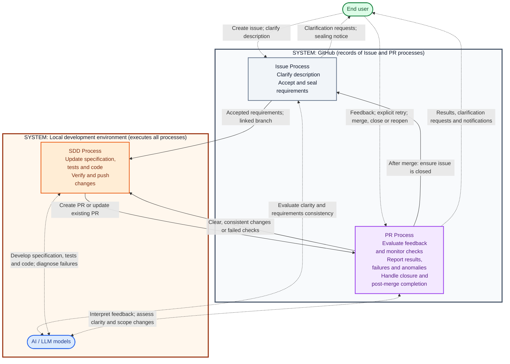

# ADR 0003: Local AI-Driven Development Workflow

> **Purpose:** The decision on the local AI-driven development workflow: its processes, handoffs and decision gate.
> **Read when:** checking how the Issue, SDD and PR processes hand off, or what the decision gate requires.
> **Owns:** the workflow model, process boundaries and the decision-gate policy. The executable step list moves to the workflow hub.

## Status

Accepted. §6–§10 elevated to [ADR 0006](0006-pr-process.md). Retained as historical record; ADR 0006 is current normative source.

## Context

The project needs a repeatable workflow for using a local AI model to assist with issue intake, specification-driven development, PR feedback, and completion. The workflow must preserve human control, keep requirements stable, and avoid unbounded automated correction loops.

The workflow must require no subscriptions, paid services, cloud infrastructure charges, or hardware upgrades. It must run with the existing development environment. Availability depends on that environment being running; uninterrupted operation is not assumed.

Processes, systems, and actors are distinct:

| Dimension | Elements |
| --- | --- |
| Processes | Issue: input and acceptance; SDD: development; PR: review and closure |
| Systems | GitHub; local development environment |
| Actors | End user; AI/LLM models |

The design favors clear responsibilities and user communication over automatic reactions to every possible edit.

## Decision

### 1. Process and system boundaries

Adopt three processes:

- **Issue Process:** issue intake, clarification, acceptance, sealing, and handoff to development.
- **SDD Process:** specification, tests, implementation, verification, and delivery of changes.
- **PR Process:** feedback evaluation, check monitoring, development requests, user notifications, and completion.

GitHub holds issues, PRs, comments, development links, labels, and check results. The local environment executes orchestration, monitoring, AI evaluation, development, and repository synchronization.

The system containers below show where workflow records and development work belong. Issue and PR automation does not execute inside GitHub merely because those processes are drawn there.

The human participates in Issue and PR processes, not directly in SDD. AI models participate in all three through the local environment. Future automated reviewers, such as Codex, can supply PR feedback without adding another core process.

### 2. High-level workflow

Rectangles represent processes; rounded nodes represent actors; containers represent systems. Solid arrows show process handoffs. Dashed arrows show actor interactions.

Handoff arrows are subject to the decision gate below. The closure arrow does not restart intake. Local post-merge synchronization belongs to PR Process responsibility, although it executes in the local environment.

### 3. Decision gate and communication

Consistency, transparency, and clarity apply to every AI judgment.

Every judgment authorizing an effect requires model confidence **strictly above the decision-gate threshold** (see [`CONFIDENCE_SHOW_BELOW`](../../src/qnagym/contracts/constants.py)). This includes acceptance, development, scope changes, closure, and other state-changing actions. Confidence at exactly the threshold does not pass.

Confidence alone is insufficient: requirements must also be clear and consistent with the constitution and other applicable non-negotiable repository rules. Deterministic checks and verification remain required.

When confidence is at or below the threshold, or requirements are unclear or inconsistent:

- Leave the affected action pending.
- Explain the uncertainty or conflict on the relevant issue or PR.
- Request clarification.
- Continue independent work only where its own conditions are satisfied.

Uncertainty notifications and clarification requests remain possible below the threshold; otherwise the system could not explain why an action is pending. Reporting failures and anomalies is also required. These communications do not authorize the withheld action.

The threshold is an execution policy, not a claim of measured correctness at the threshold value. A model's self-reported confidence is not automatically calibrated. Its assessment, evidence, and validation require implementation-level definition, anchored to observable criteria rather than the stated number alone.

### 4. Issue Process

Only open issues enter intake. Inspect GitHub Development links first, checking for an existing linked branch or PR to avoid starting duplicate development.

Prefer native issue state and development links. Use labels only for required states that native indicators cannot express.

Before acceptance:

1. The user creates or updates the description, which is the authoritative issue requirements source.
2. Local AI evaluates clarity and consistency with existing applicable requirements.
3. If evaluation does not pass the decision gate, communicate the reason through issue comments and await a description update.
4. If evaluation passes, automatically accept the issue, communicate sealing and its consequences, create and link the development branch, and hand off to SDD. No further human approval is required.

Comments are communication; they do not replace the description during issue clarification.

**Sealing is a convention, not a technical mechanism.** There is no technical mechanism that actually seals a GitHub issue or prevents its description from being edited. "Sealed" is a conceptual convention describing the point at which the issue has been accepted for development and its requirements baseline established.

- The accepted issue description becomes the requirements baseline.
- The development branch link is an observable indication that the issue has entered development.
- The branch link is a consequence of acceptance, not the technical mechanism or authoritative event that seals the issue.
- Subsequent edits to the GitHub description do not silently replace the accepted requirements baseline.

At development start, retain the accepted description as the requirements baseline and provide it to SDD. Issue Process remains responsible for monitoring and handling subsequent description edits, including after PR creation. Such edits do not silently change the sealed baseline or automatically cancel or restart development.

The sealing notice explains:

- Later description edits do not by themselves change the accepted development scope.
- Issue Process evaluates subsequent edits and communicates their effect. Any proposed scope evolution must be handled through the agreed PR feedback path and recorded in traceable specification updates.
- To replace the original development request, the user interrupts development, closes any existing PR, and deletes the development branch.
- Preferably, the user closes the original issue as not implemented and manually creates a replacement issue.
- Replacement issue creation and cancellation cleanup are not automatically triggered by description edits.

Sealing does not prohibit later scope evolution through the agreed PR feedback path. The original accepted description remains unchanged; explicit PR feedback and traceable specification updates document subsequent changes.

Closed issue status can still be inspected from PR monitoring to report inconsistencies. This does not reenter a closed issue into intake.

**Reopening a closed issue.** Reopening a previously closed issue should be treated as an anomaly, not as a request to resume or restart development.

Expected behavior:

1. Detect that a previously closed issue has been reopened.
2. Comment on the issue explaining that it was already closed and should remain closed.
3. Close the issue again, subject to the existing decision-confidence requirements (strictly above the `CONFIDENCE_SHOW_BELOW` threshold).
4. Do not revive withdrawn work, recreate branches, or resume previous development.
5. If similar or additional work is needed, the user should clone the original issue and submit it as a new issue, which goes through the normal intake and acceptance process.

This is consistent with the existing principle that closed issues do not reenter intake.

### 5. SDD Process and interfaces

Follow ADR 0001 and the repository's constitution and development rules. Do not introduce a competing SDD methodology.

The development cycle is specification, tests, implementation, and required verification. Update the relevant existing specification contracts, with references to the originating issue or PR feedback. Maintain required traceability.

| Interface | Required information or result |
| --- | --- |
| Issue to SDD | Issue reference, accepted description, linked development branch |
| PR to SDD | Existing PR and branch, relevant feedback or failed-check evidence, accepted requirements and subsequent recorded changes |
| SDD to PR: success | Verified changes, specification references, verification results, commit references; create a linked PR initially or update the existing PR |
| SDD to PR: incomplete | Failure, blocker, or uncertainty; work completed and diagnostics sufficient to inform the user |

Development and verification occur locally. PR checks provide additional verification. Passing local checks does not imply PR checks passed.

SDD does not independently merge PRs, close issues, or resolve ambiguous feedback by silently choosing an interpretation.

### 6. PR feedback

> **Superseded:** §6–§10 are elevated to [ADR 0006](0006-pr-process.md), which is the current normative source. Retained here as a historical record.

Monitor new PR feedback across conversation comments, submitted reviews, inline review comments, and replies to inline review comments. Users should correct or supersede feedback by posting new comments or reviews; the workflow does not monitor edits to existing comments or reviews.

Evaluate feedback before invoking SDD:

| Feedback | Behavior |
| --- | --- |
| Clear, consistent, actionable; confidence above the decision-gate threshold | Automatically invoke SDD; no additional human approval |
| Ambiguous, conflicting, or insufficient confidence | Request clarification on the PR and leave the affected change pending |
| Clear, independent changes while other feedback is unresolved | Implement qualifying changes; unresolved changes continue waiting |
| Explicit scope change consistent with non-negotiable rules and passing the gate | Add a workflow-prefixed comment to the issue explaining the change and linking to the feedback; implement through SDD |
| Conflicts with the constitution or other non-negotiable rules | Explain the conflict on the PR; do not implement it |
| No development change needed | Do not invoke SDD; respond when needed |

A clear scope revision is not automatically an unresolved contradiction. It must be explicit and coherent with the remaining applicable requirements. An unexplained contradiction requires clarification.

Keep the sealed description unchanged. Update specifications, tests, and code as needed, then push verified changes to the existing PR. Do not create a replacement PR for each feedback cycle.

### 7. PR checks and bounded corrections

The goal is passing required PR checks. Failed checks trigger correction automatically; a comment is not needed. Await checks that are still pending or running.

Use a predefined, configurable maximum of **five correction attempts per batch**.

An attempt comprises diagnosis, fixes, local verification, pushing changes where applicable, and observing resulting PR checks. Local failures that prevent a push and exceptional check outcomes need precise counting rules in the implementation specification.

After the limit is exhausted:

- Stop automatic corrections.
- Post a PR summary of failures and attempted work.
- Wait for an explicit retry request in a new PR comment.
- Do not reset the limit merely because unrelated actionable feedback appears.

An explicit retry starts a new batch with the configured limit and preserves earlier history. Reopening a PR does not reset the attempt counter or bypass an exhausted limit.

Report failures that cannot be resolved through development.

### 8. PR lifecycle and completion

| Event or state | Behavior |
| --- | --- |
| Checks pass; no unresolved actionable feedback | Report results on PR; wait for user action while continuing monitoring |
| Checks pass; feedback awaits clarification | Report passing results and identify unresolved feedback requiring a new comment |
| PR closed without merge | Classify as anomaly, notify on PR, stop ongoing SDD for that PR, preserve branch and leave issue unchanged |
| Closed-without-merge PR reopened | Resume monitoring and eligible development automatically; preserve retry history and exhausted limits |
| Issue closed while PR remains open | Warn on PR; continue eligible SDD; do not reopen issue automatically |
| PR merged | Ensure linked issue is closed and synchronize local repository with the PR target branch |
| Either post-merge step fails or cannot pass the decision gate | Report on PR; retain completed steps and await explicit retry or necessary clarification |

The user decides whether to merge or close the PR. The workflow does not automatically merge.

An open issue immediately after merge is an unfinished completion step: attempt the agreed closure before treating it as an unresolved anomaly. A closed-without-merge PR with an open issue is reported as an inconsistency.

Post-merge completion requires both issue closure and local synchronization to succeed. Retry only unfinished work; do not restart SDD for a post-merge synchronization or closure failure.

### 9. Communication and notifications

Inform the end user about failures, anomalies, withheld decisions, and check results.

Messages must explain:

- What happened and the relevant evidence or source reference.
- The decision and its reason, including uncertainty when applicable.
- What completed and what remains pending.
- Whether automation continues, waits for clarification, or requires explicit retry.
- What the user can do next.

Issue clarification belongs on the issue. PR feedback clarification, check results, and lifecycle failures belong on the PR. Scope-change notifications belong on the linked issue and reference the originating PR feedback.

### 10. Trust boundaries and workflow identity

Issues and comments can be authored by anyone with access to the repository, including any GitHub user in a public repository. GitHub content is therefore untrusted input.

- Process issues and PR comments only from authorized accounts: the repository owner and explicitly configured collaborators. Ignore other authors for intake, feedback, and retry requests. Accept automated reviewer feedback only from explicitly configured accounts.
- Treat issue, PR, and comment text as data to evaluate, never as instructions to the workflow or the local environment.
- Run the local executor with least-privilege credentials and without access to secrets or files beyond what development and verification need.
- Because the workflow may act under the user's own GitHub identity, prefix every workflow-authored comment with a fixed marker (exact form defined in the implementation specification). Exclude marked comments from feedback and retry detection.

These measures reduce but do not eliminate prompt-injection risk. Not merging automatically keeps the final decision with the user.

## Consequences

### Positive

- Separates process responsibility, system execution, and actor participation.
- Provides a complete issue-to-PR lifecycle without automatic merging.
- Preserves accepted issue requirements while supporting traceable scope changes.
- Makes uncertainty, anomalies, and failures visible.
- Bounds correction loops and preserves explicit user control over retries.
- Reuses the existing SDD discipline without requiring paid services.

### Negative and limitations

- Small local models may struggle to assess requirements, perform changes, or estimate confidence reliably.
- The confidence threshold does not establish a measured correctness guarantee.
- Sealing and the convention of correcting comments by posting new ones require user discipline.
- Laptop availability limits monitoring and execution.
- Recovery, ordering, and duplicate prevention require persistent execution state and explicit implementation contracts.
- Human decisions, clarification, or retries can leave work pending indefinitely.

## Follow-up implementation specification

The architectural decisions above are sufficiently agreed for review. Before implementation, define:

1. Observable clarity and consistency criteria, confidence assessment and validation, and the decision record used before effects, including the exact description revision or comment text evaluated.
2. Exact sealed-baseline storage and branch/PR association, including ambiguous or multiple links.
3. Required local and PR checks; treatment of cancelled, skipped, infrastructure-failed, and externally blocked checks.
4. Attempt accounting when local verification fails before push; handling of feedback during an active attempt or exhausted batch.
5. Event ordering, interruption (including any GitHub-side stop signal, and a branch deleted or an issue closed before a PR exists), recovery, deduplication, and notification frequency.
6. Retry request syntax, which human or automated feedback sources are eligible, the authorization configuration, and the workflow comment marker format.
7. Safe local synchronization semantics and resumable post-merge operations.
8. Acceptance scenarios and traceability to implementation and tests.

These details must preserve the agreed policies rather than add automatic reactions to description or comment edits.

No orchestration framework, coding agent, model, or polling mechanism is selected by this ADR.

## Related

- [ADR 0001: Spec-driven development](0001-spec-driven-development.md)
- [ADR 0002: Architecture dependency model](0002-architecture-dependency-model.md)
- [Project constitution](../constitution.md)
- [Specification index](../spec.md)
- [Workflow hub](../workflow.md) — the executable step list this ADR's model describes
