# ADR 0004: Worker and Task Execution Model

## Status

Proposed

## Date

2025-01-15

## Related

- [ADR 0003: Local AI-driven development workflow](https://github.com/hlsekowski/qnagym/blob/main/docs/adr/0003-local-development-workflow.md)
- [Project constitution](https://github.com/hlsekowski/qnagym/blob/main/docs/constitution.md)
- [Backlog: multi-worker runtime (#9)](https://github.com/hlsekowski/qnagym/issues/9)

## Context

[ADR 0003](https://github.com/hlsekowski/qnagym/blob/main/docs/adr/0003-local-development-workflow.md) defines three processes (Issue, SDD, PR), their handoffs, and their policies. It draws handoffs as direct arrows and speaks of "monitoring", "awaiting", and "continuing" as if they were activities. It leaves event ordering, interruption, recovery, and deduplication to the implementation specification (ADR 0003, follow-up item 5).

Whatever the hardware, the platform limits how much work runs at the same time, whether it is one laptop or a cluster. Issues are independent of each other. The natural model is a set of workers (currently one) and a set of tasks: when a worker is free, the next task is processed. This holds for every kind of work in the project, whether it belongs to the Issue, SDD, or PR process.

This ADR defines that model as vocabulary, invariants, and policies for executing the processes of ADR 0003. It does not change the policies of ADR 0003 (decision gate, sealing, correction limit, notifications, trust boundaries). Those remain authoritative and are not restated here.

The constraints of ADR 0003 apply unchanged: no subscriptions, paid services, cloud infrastructure charges, or hardware upgrades, and no assumption of uninterrupted availability. The first iteration deliberately favors a simple model: a task is not interrupted once it has started. Interruption and other refinements are recorded as deferred.

This ADR selects no framework, queue implementation, container runtime, workflow engine, model, or polling mechanism.

## Decision

### 1. Vocabulary

| Term                | Meaning                                                                                                                                                                  |
|---------------------|--------------------------------------------------------------------------------------------------------------------------------------------------------------------------|
| Work item           | An issue and everything linked to it: its development branch and PR(s). Identified by the issue number. Which issues become work items is defined by the Issue Process.   |
| Task                | A bounded unit of execution for one step of one process, belonging to one work item. Observation tasks are the exception (section 5).                                    |
| Task kind           | The type of step, such as issue evaluation, SDD cycle, feedback evaluation, check-result handling, post-merge completion, or observation. The set of kinds is defined in the implementation specification. |
| Worker              | Executes one task at a time. The number of workers is configuration; currently one.                                                                                      |
| Queue               | The pending tasks. It is not a source of truth (section 6).                                                                                                              |
| Claim               | The exclusive right of one worker to run one task, with an expiry.                                                                                                       |
| Execution state     | Durable local records that must survive restarts (section 6).                                                                                                            |
| Short / long        | Two priority classes. Each task kind is assigned to one of them in the implementation specification.                                                                     |
| Logical task        | The unit of work identified by task identity (section 3). It may span multiple execution attempts.                                                                       |
| Execution attempt   | One run of a logical task. Infrastructure retries are additional execution attempts of the same logical task.                                                            |
| Generation          | A monotonically increasing counter for explicit retry requests, included in task identity to distinguish a new logical task from a retry of the same one.                |
| Isolated workspace  | A temporary, disposable working directory for a task, allowing concurrent tasks of different work items to operate without interference.                                   |

### 2. Tasks are bounded steps

A task performs one step and ends with an outcome. The outcome creates the next tasks, records state, or leaves the work item waiting. A handoff in ADR 0003 section 2 means creating a task, not calling the next process. The next step starts when a worker is free.

A task never waits for a person, for PR checks, or for any other external party. Waiting is a state of the work item, not a running task. A task is created only after the event it depends on has occurred, or when its not-before time arrives (section 4). Where ADR 0003 says to monitor, await, or continue, it describes this state and the effect of observation (section 5), not an activity that occupies a worker. Local work, such as model calls and local verification, is part of the task.

A correction attempt (ADR 0003 section 7) can span several tasks, for example one task that diagnoses, fixes, verifies locally, and pushes, and a later task that handles the resulting PR check results.

Illustration, non-normative; task kind names are examples:

```
evaluate issue #42, revision 1  -> asks for clarification; ends
  ... user edits the description: no task exists, no worker is occupied ...
evaluate issue #42, revision 2  -> accepted; branch created; SDD task created; ends
run SDD cycle for #42           -> verified push; PR created; ends
  ... CI runs: no task exists, no worker is occupied ...
handle check results of the PR  -> checks failed; correction task created; ends
```

A logical task ends in exactly one of three ways:

- **Completed:** the step ran to an outcome. Negative outcomes are completed tasks: a clarification request, a pending decision gate, or the incomplete SDD result with diagnostics (ADR 0003 section 5).
- **Failed:** the retry limit was exhausted without the step reaching an outcome (section 7). This is a terminal state; no further automatic execution attempt is made.
- **Obsolete:** its work item was withdrawn. This may occur before any effect, or after some effects have already been completed (section 7).

An execution attempt may fail without ending the logical task. When an attempt fails because of an infrastructure failure or maximum duration, and the retry limit has not been reached, the same logical task remains eligible for another attempt after its retry delay. Restart rebuilds the queue from execution state; it does not change the logical task state.

```mermaid
stateDiagram-v2
    [*] --> Queued: created
    Queued --> Running: claimed by a free worker
    Running --> Completed: outcome recorded, next tasks created
    Running --> Obsolete: work item withdrawn
    Running --> Queued: retryable attempt failure; retry limit not reached
    Running --> Failed: retry limit reached
    Completed --> [*]
    Failed --> [*]
    Obsolete --> [*]
```



**Logical task vs. execution attempt.** The states above describe the logical task lifecycle. Each logical task may have multiple execution attempts. Attempt number, outcome, retry deadline, and claim are tracked in execution state (section 6). A retryable attempt failure returns the logical task to `Queued`; only exhaustion of the retry limit makes it terminally `Failed`.

### 3. Independence and scheduling

- **Independence.** Tasks of different work items do not depend on, wait for, or read each other's state. The workflow does not compare work items with each other. They share only the target branch and the platform limit. Content conflicts that result from this surface at merge, where the user resolves them (see follow-up item 10).
- **One running task per work item.** At most one task of a work item runs at a time, regardless of the number of workers. This requires an exclusive claim with an expiry (section 7); the mechanism is defined in the implementation specification.
- **Eligibility and parallelism.** A task is eligible when its not-before time has been reached and its work item has no running task. A free worker claims the next eligible task. The number of configured workers is the platform limit.
- **Order.** Among eligible tasks, short tasks go ahead of long tasks. Otherwise tasks are ordered by event time, then by creation time. A running task is never preempted.
- **Uninterruptible.** Once claimed, a task runs to completion, failure, or its maximum duration. Nothing suspends or preempts it. New input for its work item, such as feedback, a description edit, or a closure, is handled by later tasks.
- **Coalescing.** Inputs for the same work item that arrive before a task starts produce one task per kind, which evaluates the latest state. They do not produce one task per input. Coalescing must preserve all unprocessed event identifiers (for example, distinct PR feedback comments or check results); it must not discard them.
- **Identity.** A task is identified by its kind, its work item (unless repository-scoped), its task target (including the PR number when PR-specific), and the revision of the input it evaluates or the stable identifiers of the input events being evaluated (for example a description revision, the latest feedback, or a head commit). An explicit generation is included when a new logical task is authorized by an explicit retry request. The exact form per kind is defined in the implementation specification. Creating a task whose identity is already queued, running, successfully completed, or terminal Failed has no effect. Infrastructure retries are additional execution attempts of the same logical task; they do not create a new logical task identity. An explicit retry request creates a new task generation linked to the previous task and its retry authorization; it does not erase previous execution history or bypass the correction-attempt policy of ADR 0003. Coalescing and duplicate prevention, including after a restart, rely on this.

**Retry generation invariant.** The generation counter is stored in execution state (section 6) and incremented only by an explicit retry request. It is part of task identity, so a new generation creates a distinct logical task identity that is not deduplicated against the previous generation. Across restarts, the generation is recovered from execution state; a task whose identity (including generation) is already terminal Failed will not be recreated.

### 4. Time

Every task carries:

- **Created time:** when the task was created.
- **Not-before time:** the task is not eligible earlier. All delays are expressed this way, such as the delayed start of issue evaluation, the observation interval, and the spacing of retries. A delay is a property of the task, never a worker waiting.
- **Event time:** when the triggering event occurred on GitHub. It is absent for tasks triggered by time. After downtime, tasks are created all at once; event time preserves the real order of what happened.

**Event-time-absent ordering fallback.** When event time is absent, tasks are ordered by created time, then by a deterministic tiebreaker (task kind, work item, target). This ensures a stable, reproducible order for time-triggered tasks.

All times are Unix epoch seconds, UTC.

### 5. Observation

Observation is a task kind. It belongs to the repository, not to a work item. It is bounded: it reads GitHub, creates tasks, and ends. It never calls a model, and its only effect is creating tasks. Before creating a task it applies the trust boundaries of ADR 0003 section 10 (authorized accounts, workflow marker).

Observation is classified as a short task (section 3), because it is the only producer of tasks and must not be blocked behind long tasks.

Each run creates the next observation task with a not-before time of now plus a configured interval. Process startup creates the first one. At most one observation task exists at any time. The interval is configuration; GitHub request limits are handled in the implementation specification. This iteration has no separate event-detection component.

Observation runs on a worker. While a long task occupies the only worker, observation waits (see Consequences).

Retry exhaustion of a non-observation task does not affect the observation schedule. If an observation task exhausts its retries, its terminal-failure transition must durably create the successor observation task together with the terminal failure record. This keeps the observation loop running without depending on another successful observation. A repository-wide observation failure is reported through repository-level diagnostics (section 7).

**Watermark consistency.** An observation watermark must never be advanced until every event up to that watermark has a corresponding task or durable outcome recorded. Task/outcome recording and watermark advancement must be atomic; where a single atomic commit is unavailable, task/outcome creation must be idempotent by identity so a crash before watermark advancement can safely replay the events. The watermark is part of execution state (section 6) and must reflect only fully processed events.

### 6. Execution state and restart

Execution state holds what cannot be rebuilt from GitHub alone, for example:

- Logical task identities and lifecycle states
- Execution attempt counters and retry deadlines
- Correction-attempt accounting and explicit retry authorizations
- Decision records and the input revisions they evaluate
- Sealed requirement baselines and relevant fingerprints
- Observation watermarks and processed source identifiers
- Effect intents, identifiers, and recorded outcomes
- Claim ownership, expiry, and fencing generations
- Scheduling information, including deadlines that must survive restart

Its content is defined in the implementation specification.

The queue is disposable. It is a scheduling view derived from GitHub state and durable execution state. After a restart or downtime, the queue starts empty. Claims from the previous run expire according to their expiry time; they are not released merely because a new process starts. Observation then creates the tasks that are needed, derived from the current GitHub state and execution state. Missed events are recovered by looking at current state, not by replaying history.

Two rules follow:

- Every task, including its not-before time, must be derivable from GitHub state and execution state. A task that cannot be derived this way is a design defect. (The next observation task is derived from the observation watermark; this is why the watermark is execution state.)
- A worker keeps nothing between tasks that another worker could not rebuild from the task, the execution state, and GitHub. Disposable caches and isolated temporary workspaces are allowed.

If execution state is lost, corrupt, or unavailable, workers must fail closed: they must not produce workflow effects based on guessed attempt counts, decisions, watermarks, or deduplication history. Recovery must restore or verify the required state before effects resume.

### 7. Claims, failures, duration, and obsolete tasks

**Claims**

A claim grants one worker exclusive execution rights for a task and has an expiry.

A claim contains at least:

- Task identity
- Worker identity
- Expiry time
- A monotonically increasing fencing generation

Claim acquisition must be atomic. Two workers must not acquire valid claims for the same task or for concurrent tasks of the same work item.

A running worker must renew its claim before expiry. Before producing an effect, it must establish that it still owns the current claim and fencing generation.

A worker that loses its claim must stop executing and must not produce further effects. Effects must be dispatched through a guarded mechanism that rejects stale claim generations. Task code must not bypass that guard to perform external effects.

A claim must not be released merely because another worker or process starts. Takeover is permitted after expiry and the required ownership checks. The implementation defines how expiry and worker liveness are verified.

**Infrastructure failures**

Infrastructure failures include model unavailability or crashes, GitHub server errors, machine sleep or shutdown, and other failures that prevent a task from reaching an outcome.

A logical task is retried automatically a limited, configurable number of times, optionally spaced by a not-before time.

These execution retries are not counted against the correction attempts of ADR 0003 section 7.

After the retry limit is exhausted, the task reaches terminal `Failed` state. A durable notification intent is created for the relevant issue or PR, following the communication rules of ADR 0003. A repository-wide observation failure is reported through repository-level diagnostics instead.

Failure to deliver a notification must not cause the original task to execute again. Notification delivery follows the same safe-effect and retry rules.

**Maximum duration**

Every task kind has a configurable maximum execution duration.

A task that exceeds this duration is stopped and handled as an infrastructure failure. Its worker must lose the authority to produce further effects, even if the underlying process cannot be stopped immediately.

The implementation defines process cancellation, claim expiry, and fencing behavior so that a timed-out worker cannot continue producing effects after takeover.

Initial duration values are configuration and implementation-specification concerns, not decisions of this ADR.

**Obsolete tasks and withdrawal**

Before every externally visible effect, a task checks that its target and work item remain valid under ADR 0003.

Withdrawal is evaluated against the task target:

- An issue closed before any PR exists withdraws the work item.
- Deletion of a development branch that was previously created and associated with the work item withdraws tasks depending on that branch.
- A PR closed without merge withdraws tasks targeting that PR and its associated development work.
- A merged PR withdraws all tasks targeting that PR except its post-merge completion task.
- Closing an issue while a PR remains open is not withdrawal.

A PR-specific lifecycle event does not automatically withdraw tasks targeting a different PR linked to the same issue.

The absence of a branch before its initial creation is not branch deletion.

If withdrawal is detected before any effect, the task ends as `Obsolete` without effects. If some effects have already been completed, the task stops producing further effects, records the partial outcome, and ends as `Obsolete`. Previously completed effects are not automatically rolled back.

**Safe effects**

Every effect must be safe to retry or resume.

Before dispatching an effect, the implementation persists its intent with a stable identifier derived from the task and effect step. It records the outcome after dispatch.

If a machine stops or a response is lost after an effect may have succeeded, the implementation reconciles the external state using the effect identifier or other verifiable evidence before retrying.

Examples:

- A comment must be identifiable so that a retry does not create a duplicate.
- Branch creation must check for an already existing branch and verify its association.
- A push must verify the expected branch state before updating it.
- Issue and PR state changes must verify the current state before repeating an operation.

If the effect outcome cannot be established, the implementation must report uncertainty rather than blindly repeat a potentially non-idempotent effect.

The exact effect identifiers, reconciliation procedures, and storage format are implementation-specification concerns.

### 8. Observability

Observability follows constitution rule C10:

- Structured logs at I/O boundaries.
- A trace ID per task, linking it to the task that created it.
- Metrics for queue wait time, execution duration, and outcome per task kind.

Logs should identify the task, worker, work item, target, execution attempt, and input revision where applicable, while respecting the project's security and privacy rules.

Queue wait time is a metric, not a task timeout.

A metric for task creations suppressed by identity is added, so that identity bugs are observable.

### 9. Deployment neutrality

The execution model does not depend on a particular runtime or worker count. The initial configuration is one worker in the local development environment of ADR 0003.

Adding workers on the same or different machines must preserve the invariants in this ADR, including:

- One running task per work item.
- Exclusive claims with expiry and fencing.
- Shared durable execution state.
- Isolated workspaces.
- Safe and deduplicated effects.
- Recovery after downtime.

This architectural neutrality does not authorize paid infrastructure, additional hardware, or a change to the zero-cost constraint. Hosted or paid infrastructure requires a separate decision amending ADR 0003.

Each runtime technology is decided in its own ADR when introduced. The current backlog item is [#9](https://github.com/hlsekowski/qnagym/issues/9).

### 10. Workflow decision gate

The decision gate of ADR 0003 remains authoritative and is not restated here. Task execution does not replace or bypass it.

Creating or claiming a task is not authorization to produce its effects. The decision record must be durable before the corresponding effect is performed, so a restart cannot cause the same input to be evaluated under an unrecorded or different decision.

## Consequences

### Positive

- Issues progress independently; the worker count is a configuration value.
- Waiting never occupies a worker.
- The same execution model serves Issue, SDD, and PR processes.
- The queue can be rebuilt after downtime without requiring a durable queue implementation.
- Task identity and execution attempts provide explicit deduplication and retry semantics.
- Claims and fencing protect work item exclusivity when multiple workers are introduced.
- Effects have explicit recovery and reconciliation rules.
- The 95% decision gate and workflow policies remain authoritative.
- No technology is selected prematurely.

### Negative and limitations

- A long task delays other tasks on a single worker, including observation, by up to its maximum duration.
- Feedback, check results, and clarification replies on other work items may wait.
- Without interruption, a running task may continue using input that has become stale. Newer input is handled afterwards, which can cause rework.
- Reaction latency is bounded below by the observation interval and worker availability.
- GitHub request limits constrain observation frequency.
- Tasks can execute more than once after infrastructure failures; correctness depends on effect reconciliation and deduplication.
- Execution state must be durable and consistent across workers, and its loss must be detected.
- Shared local resources, including model capacity, may limit useful parallelism.
- Short-before-long scheduling does not guarantee fairness and may starve long tasks.
- Maximum task durations must be tuned against real SDD cycles and the local model.
- GitHub and local execution state cannot be updated in one atomic transaction. The implementation must minimize and reconcile the resulting race conditions.
- Human decisions, clarification, or retries can leave work pending indefinitely.

### Deferred, not rejected

These refinements are not part of this iteration. Each would be added by a later ADR when a measured need appears:

- Interrupting a running task, with suspension and restorable state.
- Short-lived liveness signals for faster takeover of lost workers.
- Event detection as a separate component or push-based detection.
- A limit on shared model capacity when several workers use the same model.
- Time-slicing of long tasks.
- A durable queue.
- Fairness improvements such as priority aging.

## Follow-up implementation specification

Before implementation, define:

1. Task kinds for each process: scope, inputs, outcomes, effects, prerequisites, coalescing policy, short or long class, maximum duration, retry limit, and identity/input-revision format.
2. Execution state: schema, content, location, durability, shared access, atomic operations, backup/recovery, and handling of state loss; alignment with ADR 0003 follow-up items 1 and 2.
3. Claims: atomic acquisition, ownership, expiry, renewal, fencing generations, takeover, clock assumptions, and behavior with several workers on one or several machines.
4. Safe effects: effect identifiers, durable intent/outcome records, reconciliation, duplicate prevention, and behavior when an outcome is uncertain.
5. Observation: interval, enumeration and pagination, change detection, watermarks, GitHub request budget, retry exhaustion, and handling of unauthorized or workflow-marked content.
6. Withdrawal checks: target-specific lifecycle conditions, where each task kind checks them, and the GitHub state each check requires.
7. Workspace isolation for simultaneous work items and safe repository synchronization.
8. Infrastructure failure classification, retry limits and spacing, and notification delivery.
9. Attempt accounting when a correction attempt spans several tasks, including interaction with explicit retry requests.
10. Merge conflicts with the target branch: detection and reporting. Interim assumption: the user resolves them.
11. Observability: metric names, trace ID propagation, structured log fields, and PII redaction.
12. Acceptance scenarios, including multi-worker invariants verified with tasks that call no model: one running task per work item, claim expiry and takeover, stale-worker fencing, restart recovery, deduplication, coalescing, event preservation, effect reconciliation, workspace isolation, and obsolete tasks.

These details must preserve the policies agreed here and in ADR 0003. They must not add interruption, automatic reactions to description or existing-comment edits, or automatic PR merging.

No orchestration framework, queue implementation, container runtime, workflow engine, model, or polling mechanism is selected by this ADR.
