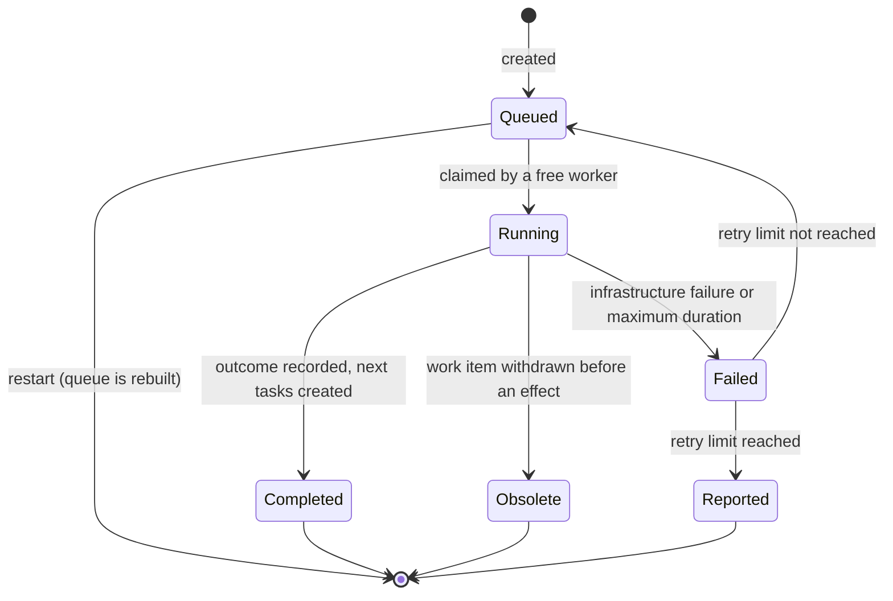

# ADR 0004: Worker and Task Execution Model

## Status

Accepted

## Context

[ADR 0003](https://github.com/hlsekowski/qnagym/blob/main/docs/adr/0003-local-development-workflow.md) defines three processes (Issue, SDD, PR), their handoffs, and their policies. It draws handoffs as direct arrows and speaks of "monitoring", "awaiting", and "continuing" as if they were activities. It leaves event ordering, interruption, recovery, and deduplication to the implementation specification (ADR 0003, follow-up item 5).

Whatever the hardware, the platform limits how much work runs at the same time, whether it is one laptop or a cluster. Issues are independent of each other. The natural model is a set of workers (currently one) and a set of tasks: when a worker is free, the next task is processed. This holds for every kind of work in the project, whether it belongs to the Issue, SDD, or PR process.

This ADR defines that model as vocabulary, invariants, and policies for executing the processes of ADR 0003. It does not change the policies of ADR 0003 (decision gate, sealing, correction limit, notifications, trust boundaries). Those remain authoritative and are not restated here.

The constraints of ADR 0003 apply unchanged: no subscriptions, paid services, cloud infrastructure charges, or hardware upgrades, and no assumption of uninterrupted availability. The first iteration deliberately favors a simple model: a task is not interrupted once it has started. Interruption and other refinements are recorded as deferred.

This ADR selects no framework, queue implementation, container runtime, workflow engine, model, or polling mechanism.

## Decision

### 1. Vocabulary

| Term            | Meaning                                                                                                                                                                  |
|-----------------|--------------------------------------------------------------------------------------------------------------------------------------------------------------------------|
| Work item       | An issue and everything linked to it: its development branch and PR(s). Identified by the issue number. Which issues become work items is defined by the Issue Process.   |
| Task            | A bounded unit of execution for one step of one process, belonging to one work item. Observation tasks are the exception (section 5).                                    |
| Task kind       | The type of step, such as issue evaluation, SDD cycle, feedback evaluation, check-result handling, post-merge completion, or observation. The set of kinds is defined in the implementation specification. |
| Worker          | Executes one task at a time. The number of workers is configuration; currently one.                                                                                      |
| Queue           | The pending tasks. It is not a source of truth (section 6).                                                                                                              |
| Claim           | The exclusive right of one worker to run one task, with an expiry.                                                                                                       |
| Execution state | Durable local records that must survive restarts (section 6).                                                                                                            |
| Short / long    | Two priority classes. Each task kind is assigned to one of them in the implementation specification.                                                                     |

### 2. Tasks are bounded steps

A task performs one step and ends with an outcome. The outcome creates the next tasks, records state, or leaves the work item waiting. A handoff in ADR 0003 section 2 means creating a task, not calling the next process. The next step starts when a worker is free.

A task never waits for a person, for PR checks, or for any other external party. Waiting is a state of the work item, not a running task. A task is created only after the event it depends on has occurred, or when its not-before time arrives (section 4). Where ADR 0003 says to monitor, await, or continue, it describes this state and the effect of observation (section 5), not an activity that occupies a worker. Local work, such as model calls and local verification, is part of the task.

A correction attempt (ADR 0003 section 7) can span several tasks, for example one task that diagnoses, fixes, verifies locally, and pushes, and a later task that handles the resulting PR check results.

Illustration, non-normative; task kind names are examples:

```
evaluate issue #42, revision 1  -> asks for clarification; ends
  ... user edits the description: no task exists, no worker is occupied ...
evaluate issue #42, revision 2  -> Proposed; branch created; SDD task created; ends
run SDD cycle for #42           -> verified push; PR created; ends
  ... CI runs: no task exists, no worker is occupied ...
handle check results of the PR  -> checks failed; correction task created; ends
```

A task ends in exactly one of three ways:

- **Completed:** the step ran to an outcome. Negative outcomes are completed tasks: a clarification request, a pending decision gate, or the incomplete SDD result with diagnostics (ADR 0003 section 5).
- **Failed:** the step could not run to an outcome because of an infrastructure failure or because it exceeded its maximum duration (section 7).
- **Obsolete:** its work item was withdrawn before the task could produce an effect (section 7).



### 3. Independence and scheduling

- **Independence.** Tasks of different work items do not depend on, wait for, or read each other's state. The workflow does not compare work items with each other. They share only the target branch and the platform limit. Content conflicts that result from this surface at merge, where the user resolves them (see follow-up item 8).
- **One running task per work item.** At most one task of a work item runs at a time, regardless of the number of workers. This requires an exclusive claim with an expiry (section 7); the mechanism is defined in the implementation specification.
- **Eligibility and parallelism.** A task is eligible when its not-before time has been reached and its work item has no running task. A free worker claims the next eligible task. The number of configured workers is the platform limit.
- **Order.** Among eligible tasks, short tasks go ahead of long tasks. Otherwise tasks are ordered by event time, then by creation time. A running task is never preempted.
- **Uninterruptible.** Once claimed, a task runs to completion, failure, or its maximum duration. Nothing suspends or preempts it. New input for its work item, such as feedback, a description edit, or a closure, is handled by later tasks.
- **Coalescing.** Inputs for the same work item that arrive before a task starts produce one task per kind, which evaluates the latest state. They do not produce one task per input.
- **Identity.** A task is identified by its kind, its work item, and the revision of the input it evaluates (for example a description revision, the latest feedback, or a head commit). The exact form per kind is defined in the implementation specification. Creating a task whose identity is already queued, running, or successfully completed has no effect. Coalescing and duplicate prevention, including after a restart, rely on this.

### 4. Time

Every task carries:

- **Created time:** when the task was created.
- **Not-before time:** the task is not eligible earlier. All delays are expressed this way, such as the delayed start of issue evaluation, the observation interval, and the spacing of retries. A delay is a property of the task, never a worker waiting.
- **Event time:** when the triggering event occurred on GitHub. It is absent for tasks triggered by time. After downtime, tasks are created all at once; event time preserves the real order of what happened.

All times are Unix epoch seconds, UTC.

### 5. Observation

Observation is a task kind. It belongs to the repository, not to a work item. It is bounded: it reads GitHub, creates tasks, and ends. It never calls a model, and its only effect is creating tasks. Before creating a task it applies the trust boundaries of ADR 0003 section 10 (authorized accounts, workflow marker).

Each run creates the next observation task with a not-before time of now plus a configured interval. Process startup creates the first one. At most one observation task exists at any time. The interval is configuration; GitHub request limits are handled in the implementation specification. This iteration has no separate event-detection component.

Observation runs on a worker. While a long task occupies the only worker, observation waits (see Consequences).

### 6. Execution state and restart

Execution state holds what cannot be rebuilt from GitHub alone, for example attempt counters, decision records, baseline fingerprints, and observation watermarks. Its content is defined in the implementation specification.

The queue is disposable. After a restart or downtime, the queue starts empty and claims left by the previous run are released. Observation then creates the tasks that are needed, derived from the current GitHub state and execution state. Missed events are recovered by looking at current state, not by replaying history.

Two rules follow:

- Every task, including its not-before time, must be derivable from GitHub state and execution state. A task that cannot be derived this way is a design defect.
- A worker keeps nothing between tasks that another worker could not rebuild from the task, the execution state, and GitHub. Disposable caches are allowed.

### 7. Failures, duration, and obsolete tasks

- **Infrastructure failures** (model unavailable or crashed, GitHub server errors, machine sleep or shutdown): the task is retried automatically a limited, configurable number of times, optionally spaced by a not-before time. These retries are not counted against the correction attempts of ADR 0003 section 7. After the limit, the failure is reported on the work item as required by ADR 0003 section 9. The same task identity is not created again automatically; how work resumes is defined together with the retry request in the implementation specification.
- **Maximum duration.** Every task kind has a configurable maximum running time. A task that exceeds it is stopped and handled as an infrastructure failure. Initial values are defined in the implementation specification and configuration, not in this ADR. A claim expires at the maximum duration of its task, so a lost task cannot block its work item indefinitely.
- **Obsolete tasks.** Before every externally visible effect (push, comment, state change), a task checks that its work item has not been withdrawn. Withdrawal means one of: the PR was closed without merge; the development branch was deleted; the issue was closed before any PR exists; or, for every task kind except post-merge completion, the PR was merged. If the work item is withdrawn, the task ends as obsolete, produces no effect, and is not retried. Closing an issue while a PR is open is not withdrawal (ADR 0003 section 8). This handles the stop signals named in ADR 0003 follow-up item 5 without interrupting running tasks.
- **Safe effects.** Every effect must be safe to retry or resume: repeating a task after a failure must not duplicate effects that already happened, such as a comment, a branch creation, or a push. The steps of a handoff (accept, create and link the branch, create the next task) must be separately safe to repeat, because the machine can stop between them.

### 8. Observability

Observability follows constitution rule C10: structured logs, a trace ID per task that links it to the task that created it, and metrics for queue wait time, run duration, and outcome per task kind. Queue wait time is a metric, not a timeout.

### 9. Deployment neutrality

The model does not depend on where workers run or how many there are. The current configuration is one worker in the development environment of ADR 0003. Adding workers on one or several machines must not require changing the invariants above.

Hosted or paid infrastructure falls outside the constraints of ADR 0003. Using it requires a separate decision that amends ADR 0003; this ADR makes no cost claims. Each runtime technology is decided in its own ADR when it is introduced. The current backlog item is [#9](https://github.com/hlsekowski/qnagym/issues/9).

## Consequences

### Positive

- Issues progress independently; the platform limit is a configuration value.
- Waiting never occupies a worker, and the same model serves all three processes.
- Recovery after downtime comes from rebuilding the queue, so no durable queue is needed.
- Delays, retries, and the observation interval share one mechanism, the not-before time. Coalescing and duplicate prevention share another, the task identity.
- Policy-level answers exist for most of ADR 0003 follow-up item 5: ordering, deduplication, recovery, and stop signals.
- No technology is selected, so later runtimes and more workers do not require changing this decision.

### Negative and limitations

- A long task delays every other task on a single worker, including observation, by up to its maximum duration. Feedback, check results, and clarification replies on other work items wait that long.
- Without interruption, a running task continues on input that may already be stale. Newer feedback is handled afterwards, which can cause rework.
- Reaction latency is bounded below by the observation interval, and GitHub request limits constrain how short that interval can be.
- Tasks can run more than once after failures, so correctness depends on safe effects.
- Execution state must be durable, and its loss must be detected and handled.
- A lost task blocks only its own work item, and only until its claim expires.
- Maximum durations must be tuned against real SDD cycles on the local model.
- There is no fairness guarantee beyond short-before-long and event-time order.

### Deferred, not rejected

These refinements are not part of this iteration. Each would be added by a later ADR when a measured need appears:

- Interrupting a running task, with suspension and restorable state, so that new input for the same work item does not have to wait.
- Short-lived liveness signals (heartbeats) for faster takeover of lost tasks.
- Event detection as a separate component, or push-based detection.
- A limit on shared model capacity when several workers use the same model.
- Time-slicing of long tasks.
- A durable queue.

## Follow-up implementation specification

The decisions above are sufficiently agreed for review. Before implementation, define:

1. Task kinds for each process: inputs, outcomes, effects, short or long class, maximum duration, retry limit, and the task identity and input-revision format.
2. Execution state: content, location, durability, and handling of its loss; alignment with the records named in ADR 0003 follow-up items 1 and 2.
3. Observation: interval, change detection and watermarks, GitHub request budget, and skipping of unauthorized or workflow-marked content (ADR 0003 section 10).
4. Claims: the claim and expiry mechanism, release at startup, and behavior with several workers on one or several machines.
5. Infrastructure failures: which failures qualify, retry limit and spacing, and how work resumes after the limit (together with the retry request syntax, ADR 0003 follow-up item 6).
6. Withdrawal checks: where each task kind performs them and which GitHub state they read (ADR 0003 follow-up item 5).
7. Attempt accounting when a correction attempt spans several tasks (ADR 0003 follow-up item 4).
8. Merge conflicts with the target branch: detection and reporting. Interim assumption: the user resolves them.
9. Observability: metric names and trace ID propagation.
10. Acceptance scenarios, including multi-worker invariants checked with tasks that call no model: one running task per work item, claim expiry and takeover, rebuild after restart, coalescing, deferred tasks, and obsolete tasks.
11. Wording alignment of ADR 0003: a reference to this ADR, and "local development environment" as the current execution environment. This is decided separately; this ADR does not edit ADR 0003.

These details must preserve the policies agreed here and in ADR 0003. They must not add interruption or automatic reactions to description or comment edits.

No orchestration framework, queue implementation, container runtime, workflow engine, model, or polling mechanism is selected by this ADR.

## Related

- [ADR 0003: Local AI-driven development workflow](https://github.com/hlsekowski/qnagym/blob/main/docs/adr/0003-local-development-workflow.md)
- [Project constitution](https://github.com/hlsekowski/qnagym/blob/main/docs/constitution.md)
- [Backlog: multi-worker runtime (#9)](https://github.com/hlsekowski/qnagym/issues/9)
