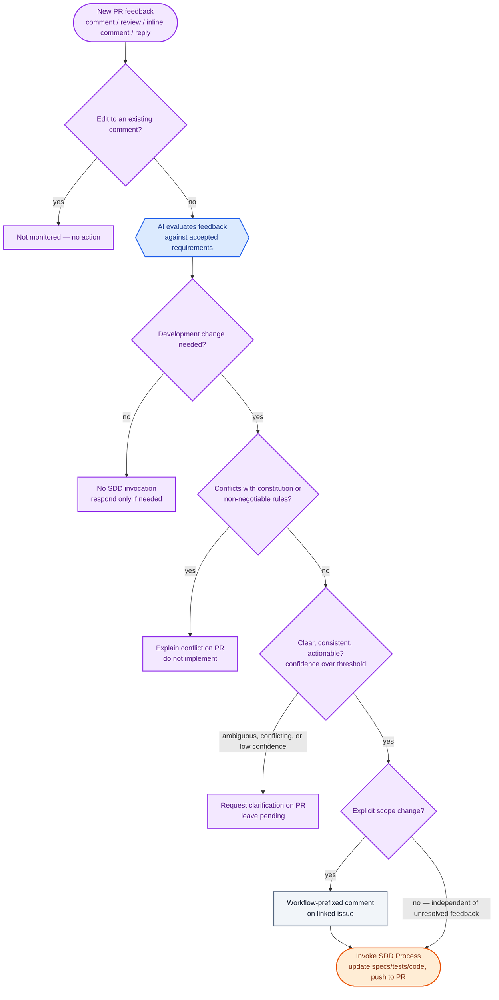
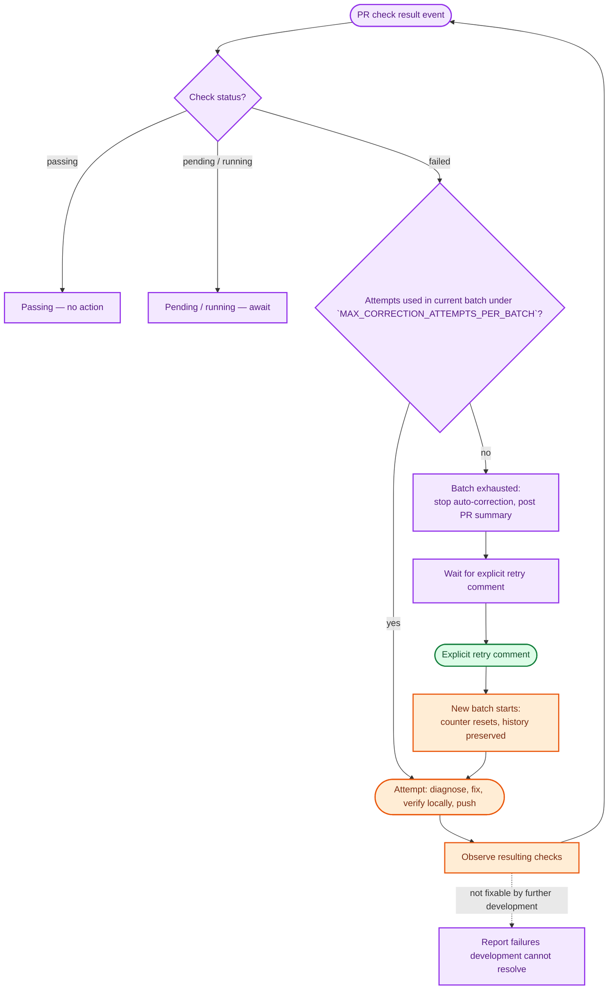
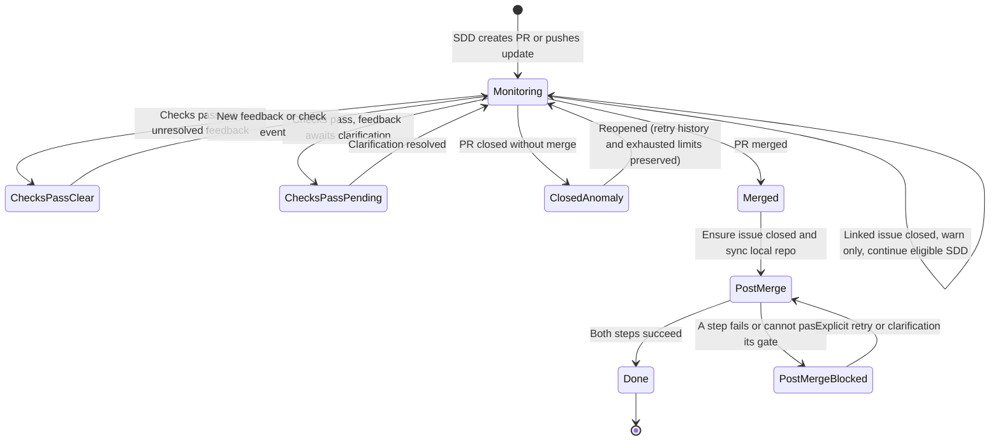

# ADR 0006: PR Process — Feedback Evaluation, Check Monitoring, Lifecycle, and Completion

- **Status:** Proposed
- **Date:** 2026-11-09 (drafted; not yet accepted)
- **Related:** ADR 0003 (Accepted — source of §6–§10, elevated here), ADR 0005 (Accepted), [issue #13](https://github.com/hlsekowski/qnagym/issues/13)

## Context

ADR 0003 §1–§2 establish the three-process model (Issue Process, SDD Process, PR Process) and the systems and actors that execute it. ADR 0003 §6–§10 then sketch, at a high level, how the PR Process should evaluate feedback, bound automatic corrections, track a PR's lifecycle, route communications, and apply trust boundaries.

This ADR does not redefine that model. It elevates ADR 0003 §6–§10 into a complete, implementable specification for the PR Process alone: the same decisions, restated as explicit control flow, with diagrams, so an implementer (or an agent) can follow it without re-deriving behavior from prose. It assumes ADR 0003 §1–§2 and §5 (process/system/actor boundaries and the Issue↔SDD↔PR interfaces) as given, and does not duplicate them beyond what's needed to keep the diagrams below self-contained.

ADR 0005 is now accepted and defines the Issue Process terms this ADR references. The scope-change routing (§1 below) and issue-state language (§3) have been reconciled against ADR 0005's final terms: a workflow-prefixed comment on the linked issue remains the mechanism for scope-change notification, and "closing an issue" / "reopening a sealed issue" retain the meanings established in ADR 0003 §4 and ADR 0005 §7.

See ADR 0003 for the general workflow this ADR specializes.

## Decision

### 1. PR Feedback Evaluation (ADR 0003 §6)

Monitor new feedback across four surfaces: conversation comments, submitted reviews, inline review comments, and replies to inline comments. A user corrects or supersedes earlier feedback by posting a new comment or review, not by editing an existing one — edits to existing comments are not monitored.

This is the PR Process's internal expansion of two interfaces from ADR 0003: the dashed `PR <-.-> AI` interaction ("Interpret feedback; assess clarity and scope changes") becomes the `AI_EVAL` step, and the solid `PR --> SDD` handoff ("Clear, consistent changes or failed checks") becomes `SDDCALL`, carrying exactly the "relevant feedback ... evidence, accepted requirements and subsequent recorded changes" that ADR 0003 §5's PR-to-SDD interface row requires. The `ISSUESCOPE` step is the one place this diagram crosses into the Issue Process; it does not reopen or alter the sealed issue description, only adds a workflow-prefixed comment.

Keep the sealed description unchanged. Update specifications, tests, and code as needed, then push verified changes to the existing PR — never a replacement PR per feedback cycle.

### 2. PR Checks and Bounded Corrections (ADR 0003 §7)

Goal: get required PR checks to a passing state. A failed check triggers an automatic correction attempt with no comment needed; pending or running checks are simply awaited. Corrections are capped at a predefined, configurable maximum of `MAX_CORRECTION_ATTEMPTS_PER_BATCH` attempts per batch (defined in `src/qnagym/contracts/constants.py`).

`ATTEMPT`/`OBSERVE` are the PR Process driving the SDD Process through the same `PR → SDD` / `SDD → PR` interfaces as §1 above, just triggered by check failures rather than feedback. `RETRY` is the `HUMAN -.-> PR` interaction from ADR 0003 §2 ("Feedback; explicit retry; merge, close or reopen"). Reopening the PR does not reset the counter or bypass an exhausted limit — that's why `NEWBATCH` is reachable only through an explicit `RETRY`, never automatically.

After the limit is exhausted: stop automatic corrections, post a PR summary of failures and attempted work, wait for an explicit retry request as a new PR comment, and do not reset the counter because unrelated actionable feedback arrives in the meantime.

### 3. PR Lifecycle and Completion (ADR 0003 §8)

| Event / state | Behavior |
|---|---|
| Checks pass; no unresolved actionable feedback | Report results on the PR; wait for user action while continuing to monitor |
| Checks pass; feedback still awaits clarification | Report the passing results; separately flag the unresolved feedback that needs a new comment |
| PR closed without merge | Classify as an anomaly; notify on the PR; stop SDD activity for that PR; preserve the branch; leave the linked issue unchanged |
| Closed-without-merge PR reopened | Resume monitoring and eligible development; preserve retry history and any already-exhausted limits |
| Linked issue closed while PR remains open | Warn on the PR; continue eligible SDD work; do not reopen the issue automatically |
| PR merged | Ensure the linked issue is closed; synchronize the local repo with the PR's target branch |
| A post-merge step fails or cannot pass its gate | Report on the PR; retain whatever steps completed; await an explicit retry or clarification |

The user decides whether to merge or close a PR — the workflow never auto-merges (`HUMAN -.-> PR` in ADR 0003 §2). An issue still open right after `Merged` is treated as an unfinished completion step: the `PostMerge` state attempts the agreed closure before escalating to `PostMergeBlocked`. A `ClosedAnomaly` PR whose linked issue is still open is reported as an inconsistency, not silently left alone. `PostMerge` requires both issue closure and local sync to reach `Done`; retry only covers whichever of the two did not finish.

### 4. Communication and Notifications (ADR 0003 §9)

> The following two sections (Communication and Notifications, Trust Boundaries) are reproduced from ADR 0003 for self-containment, so the routing rules can be read without opening ADR 0003. **ADR 0003 remains authoritative**; if they diverge, ADR 0003 wins.

Unchanged from ADR 0003 §9; reproduced here because it governs every message the diagrams above produce (`CLARIFY`, `EXPLAIN`, `ISSUESCOPE`, `EXHAUSTED`, and every lifecycle report).

Routing:

- Issue-level clarification → issue comments.
- PR feedback clarification, check results, lifecycle failures → PR comments.
- Scope-change notifications → the linked issue, referencing the PR feedback that triggered it.

Every message must cover: what happened and the evidence for it, the decision made and why (including uncertainty), what's complete versus pending, the current automation state, and what the user needs to do next.

### 5. Trust Boundaries (ADR 0003 §10)

Unchanged from ADR 0003 §10; reproduced here because it gates which `NEW` feedback events and `RETRY` comments the diagrams above act on.

- Process input only from authorized accounts (owner plus configured collaborators); ignore other authors for intake, feedback, and retry requests.
- Accept automated reviewer feedback only from configured accounts.
- Treat all GitHub content as data, never as instructions.
- Run the executor with least-privilege credentials.
- Prefix every workflow-authored comment with a fixed marker; exclude marker-prefixed comments from feedback/retry detection.

## Constraints

- No paid services, no cloud infrastructure charges, no hardware upgrades (ADR 0003).
- Must comply with Constitution C4 (thin providers) and C9 (dependency minimization), and rule NC3 (no vendor SDKs).
- Decision gate for auto-invoking SDD: confidence strictly greater than the threshold defined by `CONFIDENCE_SHOW_BELOW` in `src/qnagym/contracts/constants.py`, per ADR 0003 §3.
- No automatic PR merging, under any circumstance.
- Correction loops are bounded: `MAX_CORRECTION_ATTEMPTS_PER_BATCH` attempts per batch (defined in `src/qnagym/contracts/constants.py`), configurable.

## Consequences

### Positive

- One authoritative, diagrammed specification for PR-side behavior, instead of behavior inferred ad hoc from ADR 0003's higher-level sketch.
- Bounded correction attempts and a hard no-auto-merge rule keep a human in the loop and prevent a runaway loop on a stuck PR.
- Reusing ADR 0003's actor/interface model (rather than redefining it) keeps the PR Process diagrams traceable back to the system diagram in ADR 0003 §2.

### Negative and limitations

- The configurable attempt cap means some fixable failures still require an explicit human retry rather than resolving fully automatically.
- As with ADR 0003, the confidence threshold is an execution policy, not a measured-correctness guarantee.

## Open items before this ADR can be accepted

These block moving this ADR past Proposed — unlike the follow-up items below, they affect whether the decisions in §1–§5 are even correct, not just how they get implemented.

1. ~~ADR 0005 accepted.~~ ✅ **Done** — ADR 0005 was accepted on 2026-11-08 (PR #15).
2. ~~Reconcile §1 (scope-change routing to the linked issue) and the `ClosedAnomaly`/`Merged` issue-state language in §3 against ADR 0005's final terms, once ADR 0005 is accepted. Specifically: whether a workflow-prefixed comment remains sufficient evidence of a scope change or ADR 0005 introduces a more structured record, and whether "closing an issue" / reopening a sealed issue keeps the same meaning ADR 0003 §4 implied.~~ ✅ **Done** — Reconciled. ADR 0005 §6 confirms scope changes are handled through the PR feedback path, not by the Issue Process. ADR 0005 §7 confirms closing an issue while a PR is open does not withdraw the work item (PR Process handles it), and the Issue Process never reopens or closes an issue on its own. The workflow-prefixed comment mechanism in §1 and the issue-state language in §3 are consistent with ADR 0005.

## Follow-up implementation specification

As in ADR 0003, these decisions are sufficiently agreed for review without them. They don't block acceptance; they're implementation-time detail that someone (maintainer or implementer) still needs to pin down. Items 1–4 are carried forward from ADR 0003's own follow-up list (items 3, 4, 6, 7) because they specifically concern §1–§3 above, which ADR 0003 no longer owns once this ADR is accepted.

1. Treatment of cancelled, skipped, infrastructure-failed, and externally blocked PR checks — the §2 diagram's `STATUS` node only branches on passing / pending-running / failed; it doesn't yet say what happens for these other outcomes.
2. Attempt accounting when local verification fails before a push ever happens, and how feedback arriving during an active attempt or an exhausted batch is handled — the §2 diagram draws `ATTEMPT` as if it always reaches `OBSERVE` cleanly, which isn't guaranteed.
3. Retry-request syntax, which feedback sources are eligible to trigger one under §5's authorization rules, and the exact workflow comment marker format referenced in §5.
4. Safe local-synchronization semantics and resumable post-merge operations for the `PostMerge` state in §3.
5. Maintainer review of the confidence-gate and attempt-cap values as configured in [`src/qnagym/contracts/constants.py`](https://github.com/hlsekowski/qnagym/blob/main/src/qnagym/contracts/constants.py) (the same file already holding `CONFIDENCE_SHOW_BELOW`), once implemented.
6. Traceability entries added once this ADR is implemented, per [`docs/spec/traceability.md`](https://github.com/hlsekowski/qnagym/blob/main/docs/spec/traceability.md) ("Spec section → code → tests"), one entry per §1–§5.
7. *(Tracked separately, not blocking this ADR.)* Once ADR 0005 and this ADR are accepted, ADR 0003 §4 and §6–§10 should get short "elaborated by ADR 0005 / ADR 0006" pointers so ADR 0003 doesn't remain the stale version of content these two ADRs now own.

## Related

- [ADR 0003: Local AI-Driven Development Workflow](https://github.com/hlsekowski/qnagym/blob/main/docs/adr/0003-local-development-workflow.md) — source of §6–§10, elevated here; also the source of the actor/system/interface model these diagrams reuse.
- [ADR 0005: Issue Process](https://github.com/hlsekowski/qnagym/blob/main/docs/adr/0005-issue-process.md) — accepted; defines Issue Process terms referenced here.
- [Issue #13](https://github.com/hlsekowski/qnagym/issues/13) — tracking issue for this ADR.
- [Project constitution](https://github.com/hlsekowski/qnagym/blob/main/docs/constitution.md) — C4, C9.
- [Development workflow](https://github.com/hlsekowski/qnagym/blob/main/docs/development.md) — human PR workflow this runs alongside.
