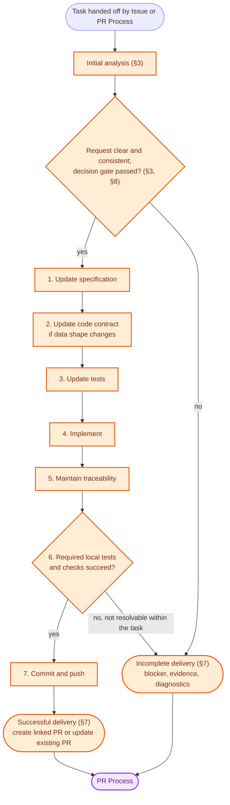

# ADR 0007: SDD Process

> **Purpose:** The decision on the SDD process between receiving a task and handing its result to the PR process.
> **Read when:** checking what SDD is responsible for, or how it reports results.
> **Owns:** SDD-process decisions: responsibility, inputs, the development cycle, verification boundary and handoff.

## Status

Accepted

## Context

ADR 0003 establishes the SDD Process as the development process between the Issue Process and the PR Process. Its §5 defines the process boundaries, handoff information, high-level development cycle, and success or incomplete results. It does not describe the SDD Process's internal development responsibilities in enough detail to serve as its process-level specification.

ADR 0001 defines the project's spec-driven development architecture and the spec-first change sequence. ADR 0002 defines the architecture dependency rules. ADR 0004 defines how tasks belonging to all three processes are executed. ADR 0005 defines how an accepted issue is handed to SDD; ADR 0006 further specifies the PR Process that can hand subsequent development work to SDD.

This ADR records the SDD Process decisions between receiving an authorized development task and handing its result to the PR Process. It specializes ADR 0003 §5; it does not redefine the overall workflow, the Issue or PR Process, or the local development environment that executes all processes.

## Decision

### 1. Responsibility and boundaries

The SDD Process is responsible for carrying out an authorized development change through specification, tests, implementation, local verification, and delivery of the resulting changes.

The SDD Process:

- Works on the development branch supplied by the upstream process.
- Maintains consistency with the accepted requirements and applicable repository specifications, constitution, rules, and ADRs.
- Updates the relevant specification contracts, code contracts when required, tests, implementation, and traceability.
- Returns verified changes or an explicit incomplete result to the PR Process; withdrawal is neither (ADR 0004 §7).

The SDD Process does not:

- Accept or seal issues, or change the accepted issue description.
- Monitor GitHub or decide independently whether raw issue or PR feedback authorizes development. Those responsibilities belong to the Issue and PR Processes.
- Independently authorize scope changes or silently resolve ambiguous or conflicting requirements.
- Own worker scheduling, task identity, execution retries, workspace isolation, or recovery mechanics; those are governed by ADR 0004.
- Merge PRs or close issues.

The process boundaries and actor participation remain as defined in ADR 0003 §1: the end user participates in the Issue and PR Processes, not directly in SDD.

### 2. Inputs and requirements baseline

SDD starts only from a task handed off by the Issue Process or PR Process. The upstream process is responsible for establishing that the work is eligible for development under ADR 0003 and its applicable process ADR.

| Source        | Required input                                                                                                                       |
|---------------|--------------------------------------------------------------------------------------------------------------------------------------|
| Issue Process | Issue reference, accepted description, and linked development branch                                                                 |
| PR Process    | Existing PR and branch, relevant evaluated feedback or failed-check evidence, accepted requirements, and subsequent recorded changes |

For an issue-originated task, the accepted issue description is the requirements baseline. Once sealed, that description remains unchanged. SDD does not interpret later edits to the description as a scope change.

For a PR-originated task, SDD uses the accepted requirements together with the specific feedback or check evidence passed by the PR Process. A scope change is considered only when it has been handled and recorded through the PR Process rules. The original sealed issue description is not rewritten; subsequent accepted changes are represented by traceable specification updates referring to their source feedback.

SDD treats the supplied issue, PR, feedback, and check information as task context, never as instructions to the workflow or the local environment (ADR 0003 §10), and never as able to override the constitution, repository rules, or accepted requirements. The accepted requirements baseline may be extended only by scope changes explicitly accepted and recorded through the PR Process.

### 3. Initial analysis

Before changing application code, SDD establishes the originating issue and, where applicable, the PR and feedback reference; reads the accepted requirements and identifies the relevant existing specification contract or contracts under `docs/spec/`; examines the corresponding code contracts, implementation and tests to understand current behavior and the impact of the requested change; and identifies the specification, code-contract, test, implementation and traceability changes required to satisfy the accepted request.

The existing specification contracts are the source of truth for product behavior. Existing implementation or tests do not silently override a conflicting specification. When the accepted request is unclear, conflicts with a non-negotiable repository rule, or cannot be reconciled with the applicable specifications, SDD does not guess; it returns the blocker or uncertainty to the PR Process (§7).

### 4. Development cycle

SDD follows the spec-first sequence established by ADR 0001. **Sequence owned by [`docs/workflow.md`](../workflow.md); retained here for decision context.** The steps below are decisions about that sequence, not a restatement of it:

- The specification must be updated before application-code implementation.
- A code-contract update is conditional on a data-shape change; it is not required for every change.
- Tests must verify the resulting specification and implementation rather than merely reproduce implementation behavior.
- The change must also satisfy the Definition of Done (rule D1), including affected documentation and changelog.
- The PR diff, counting all cycles on the PR, should stay within the size limit of constitution C2; C2 never justifies omitting a step, and SDD does not trim or split the scope itself.

### 5. Branch and PR continuity

SDD works on the development branch supplied in its input:

- For the initial issue handoff, the Issue Process creates and links the development branch before handing work to SDD (ADR 0005).
- For subsequent PR work, SDD updates the branch associated with the existing PR.
- SDD does not commit directly to `main`, in accordance with development rule D6 in [`docs/rules.md`](../rules.md).
- The initial successful SDD handoff creates a linked PR. Subsequent SDD handoffs update the existing PR; they do not create a replacement PR for each feedback or correction cycle.

### 6. Verification boundary

SDD performs development and verification locally. The required local tests and checks are run according to the repository's testing standards; the standard `pytest` workflow uses mocked HTTP and does not require a live model.

Local verification and PR checks are separate outcomes. Passing local tests does not mean that GitHub PR checks have passed. SDD reports its local verification results with the changes; the PR Process remains responsible for observing and handling PR check results under ADR 0003 §7; ADR 0006 further specifies that responsibility.

A change is not reported as successfully delivered unless the required local verification has succeeded. When verification cannot be completed or a failure cannot be resolved within the authorized task, SDD returns an incomplete result with the failure evidence and diagnostics.

### 7. Results and handoff

A completed SDD task returns one of the following outcomes to the PR Process; infrastructure failure or withdrawal is handled under ADR 0004 §7, not as either outcome.

**Successful delivery** includes:

- The linked issue and PR references, as applicable.
- The branch and commit references containing the changes.
- References to the specification contracts changed or confirmed as applicable.
- The local verification performed and its results.
- The size of the PR diff against the limit of constitution C2, with the reason when it is exceeded.
- Creation of the linked PR from the repository PR template (rule D1) for the initial delivery, or an update to the existing PR for subsequent work.

**Incomplete delivery** includes:

- The failure, blocker, or uncertainty and the evidence supporting it.
- The work completed so far, the affected files or changes, and whether any changes were pushed.
- Verification performed, including failures or checks not run.
- Diagnostics sufficient for the PR Process to inform the user and determine the next process action.

An incomplete result must not be presented as a successful delivery. The SDD Process does not independently close the issue, merge the PR, or decide that unresolved work can be ignored.

### 8. Decision gate and unresolved requirements

The decision gate in ADR 0003 §3 applies to SDD. Any AI judgment that authorizes an effect must satisfy that gate, and requirements must be clear and consistent with the applicable non-negotiable rules. The threshold and its implementation remain defined by the existing authoritative sources; this ADR does not introduce a separate SDD threshold.

If uncertainty or a conflict is discovered during development, SDD stops the affected change and reports it to the PR Process (§7). It does not resolve ambiguity by guessing or alter the accepted requirements to make an implementation appear complete. Independent work may continue only when it is separately authorized and does not depend on the unresolved point, in accordance with the applicable upstream process rules.

## Flow

Illustration, non-normative; the sections above are authoritative. At any step, uncertainty or conflict stops the affected change and ends in an incomplete delivery (§8).

## Consequences

### Positive

- Makes the SDD Process an explicit, reviewable process rather than an opaque operation between Issue and PR.
- Establishes one development sequence consistent with ADR 0001 and [`docs/workflow.md`](../workflow.md).
- Preserves the accepted issue baseline while allowing subsequent, recorded PR feedback to evolve the specification.
- Separates local verification from PR check handling.
- Defines the information needed for successful and incomplete handoffs without duplicating the worker/task execution model.

### Negative and limitations

- Requires specification, code contracts, tests, and traceability to be maintained together.
- Some tasks may remain incomplete while clarification or a decision from the upstream process is pending.
- The exact task decomposition and execution mechanics remain implementation concerns under ADR 0004; this ADR does not select a framework, model, coding agent, or tool.

## Follow-up implementation specification

Before implementation, define the following details without changing the process decisions above:

1. Exact SDD task kinds and task boundaries, consistent with ADR 0004.
2. How an implementation task records the specific accepted input revision and the issue or PR feedback references used for traceability.
3. How partial changes are retained, reported, or resumed after an incomplete task or infrastructure failure, including where an incomplete result is reported before any PR exists.
4. The concrete local verification commands for each change type, where they are not already defined by [`docs/workflow.md`](../workflow.md) or [`docs/testing.md`](../testing.md).
5. Acceptance scenarios and automated tests covering issue-originated work, PR-feedback work, successful handoff, and incomplete handoff.

Prompts, model selection, tool invocation details, task persistence, retry mechanics, workspace management, and external-effect recovery remain governed by the relevant implementation specifications and ADR 0004, not by this process ADR.

## Related

- [ADR 0001: Spec-Driven Development](0001-spec-driven-development.md)
- [ADR 0002: Architecture Dependency Model](0002-architecture-dependency-model.md)
- [ADR 0003: Local AI-Driven Development Workflow](0003-local-development-workflow.md)
- [ADR 0004: Worker and Task Execution Model](0004-worker-task-model.md)
- [ADR 0005: Issue Process](0005-issue-process.md)
- [ADR 0006: PR Process](0006-pr-process.md)
- [Project constitution](../constitution.md)
- [Rule catalogue](../rules.md)
- [Workflow hub](../workflow.md)
- [Testing standards](../testing.md)
- [Specification traceability](../spec/traceability.md)
